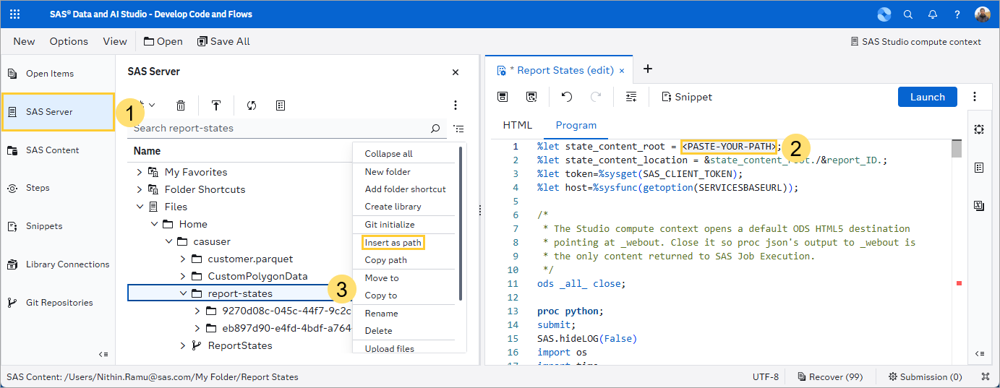
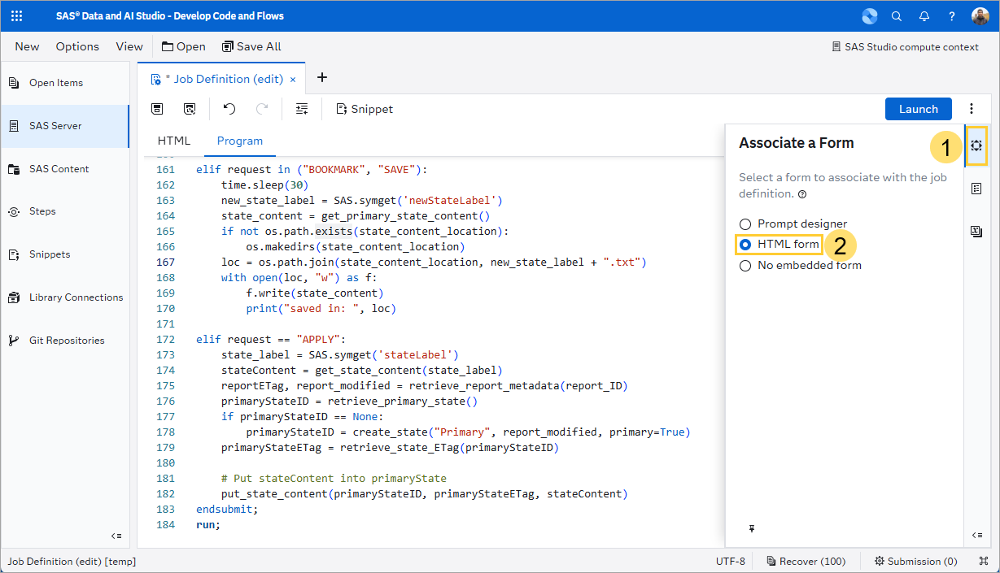
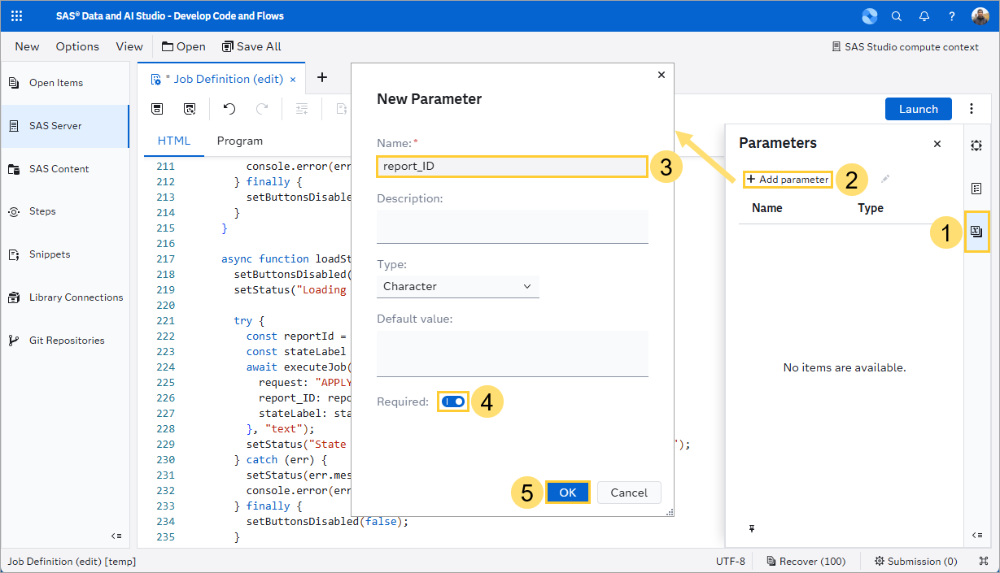
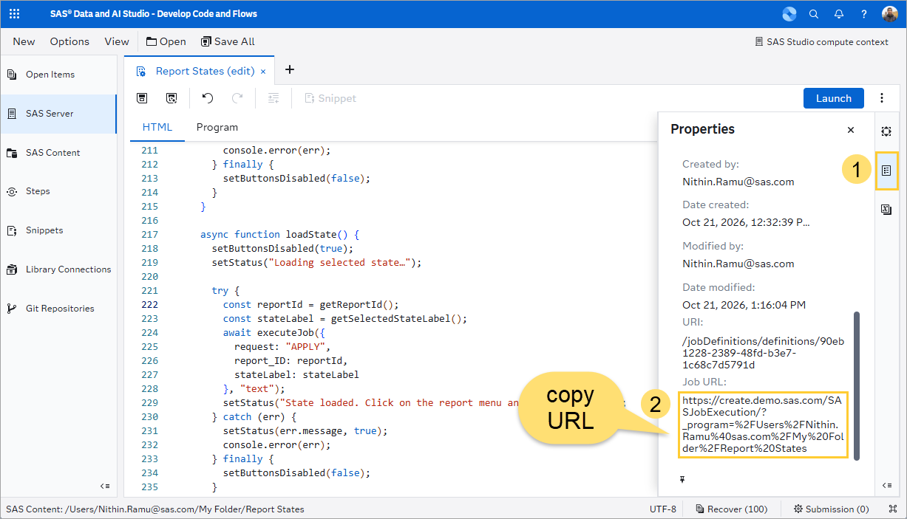
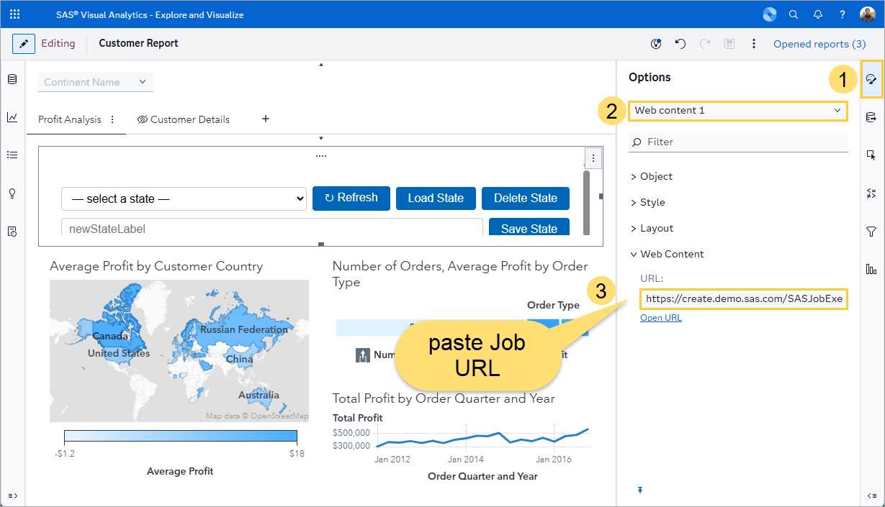
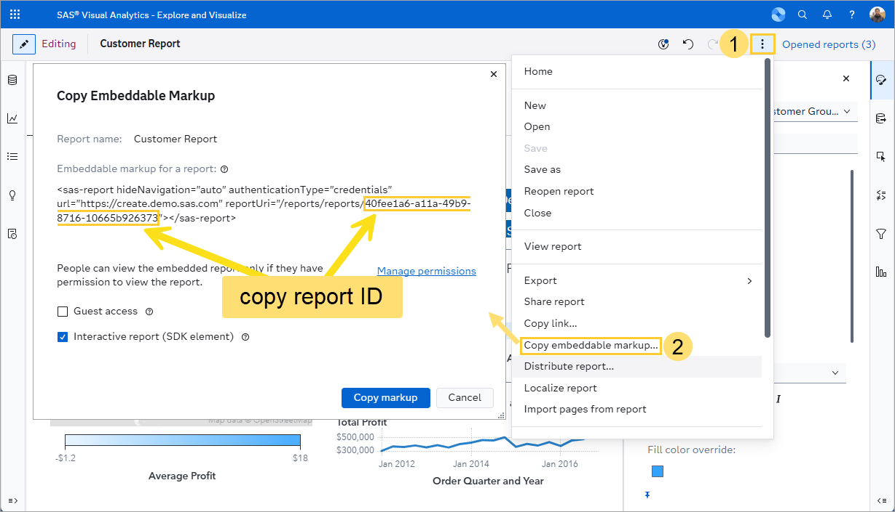
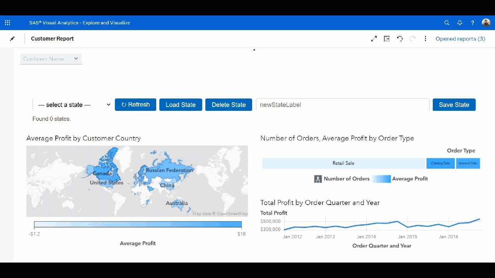

# Report States

This repository contains files to save, delete and reapply report states for SAS Visual Analytics reports. You can do this using a no code interface or using code.

## What is a Report State

By default, SAS Visual Analytics maintains the state of each user's report (or the most recent view of a report) across sessions. The first time a report viewer opens a report, they see it in the state the report was saved. Then, suppose the report viewer changes prompt values and drills into a hierarchy. The next time that user views the same report, SAS Visual Analytics displays the report with the prompt values and drill state from the previous session (unless report state has been disabled).

The report state contains:

- Prompt values
- Drill-down
- Selections in objects
- Interactions between objects
- Sorts
- Filter applied by the report viewer
- Ranks applied by the report viewer
- Display Rules applied by the report viewer
- Data Roles assigned by the report viewer
- Options modified by the report viewer

Suppose you have a dashboard that displays comprehensive data about a company's operations. You are responsible for different parts of the business and find yourself always selecting the same interactive filters, drill-downs and sorts. You might be interested in saving each report state, so you can easily reapply it later.

## No Code Interface for Report State Selector

Here, we create a SAS Viya Job with a HTML form that we can then display in a SAS Visual Analytics report using the web content object. The no code interface requires a one-time setup, detailed below.

### First-Time Setup

#### Create SAS Viya Job

In SAS Data & AI Studio, click on **New** and **Job definition**. Paste the content of job.sas into the **Program** tab.

We need to change the first line of the program. This specifies the folder on the SAS Server (not SAS Content!) where the report state files are saved. On the left, click on the **SAS Server** pane. Then, find a folder for which you have write permissions. (To test whether this is the case, right-click on a folder and try adding a subfolder.) If you want the report states to be available to your colleagues, ensure this is a folder they have access to. Next, on the first line of the code, highlight `<PASTE-YOUR-PATH>` (not including the semicolon at the end). Then, right click on the chosen folder and select **Insert as path**.

Ensure the path was added correctly. The line should look as follows:

`%let state_content_root = /create-export/create/homes/Nithin.Ramu@sas.com/casuser/report-states;`

On the **Associate form** pane on the right, click on **HTML form**.

Then, in the **HTML** tab, paste the contents of jobForm_v3.sas.

Next, click on the **Parameters** pane on the right. Click on **New parameter**. Add a parameter with the name **report_ID**. Ensure the name matches exactly. This parameter is referenced in the code and will need to be supplied at the end of the job URL (more on that later).

Save the job in any location. If you want colleagues to be able to access it, save it in a folder accessible to them.

### Steps to perform for each report you want to add the report state selector to

Now, copy the **Job URL** from the **Properties** pane on the right. You will need to expand the **Details** section:

#### Add web content object linking to SAS Viya Job in SAS Visual Analytics

Now, switch to SAS Visual Analytics. Open the report you wish to add the report state selector to. Ensure you are editing the report.

From the **Objects** pane on the left, add a **Web content** object to the canvas. In the **Options** pane on the right, ensure the web content object is selected in the drop-down list. In the **Web Content** section, under **URL**, paste the Job URL:

#### Copy report ID

Save the report. From the report menu, click on **Copy embeddable markup**. In the sas-report HTML attribute, in the reportURI attribute, select the part after **/reports/reports/** and copy it using the **CTRL+C** keyboard shortcut:

#### Append report ID to web content object URL

In the **Options** pane on the right, ensure the web content object is selected in the drop-down list. In the **Web Content** section, under **URL**, append `&report_ID=<your_report_ID>` to the end of the URL (ensure you replace <your_report_ID> with the report ID you copied in the previous step):

For example, the full URL should have the form: `https://create.demo.sas.com/SASJobExecution/?_program=%2FUsers%2FNithin.Ramu%40sas.com%2FMy%20Folder%2FReport%20States&report_ID=40fee1a6-a11a-49b9-8716-10665b926373`

Save the report. Then, switch to view mode. You are now ready to save and reapply report states!

### Try it Out

Here is a demo:

## Using Code

This repository also has code that uses the SAS(R) Viya(R) REST API to:

1. get a list of report states
1. bookmark (save) a report state
1. apply a saved report state to a report
1. delete a report state, and
1. restore the report state defined by the report creator for SAS Visual Analytics reports.

Please see the blogs: Bookmarking Report States using the Reports API and Resetting Report States using the Reports API and SAS® Viya Jobs on SAS Communities for more info.
